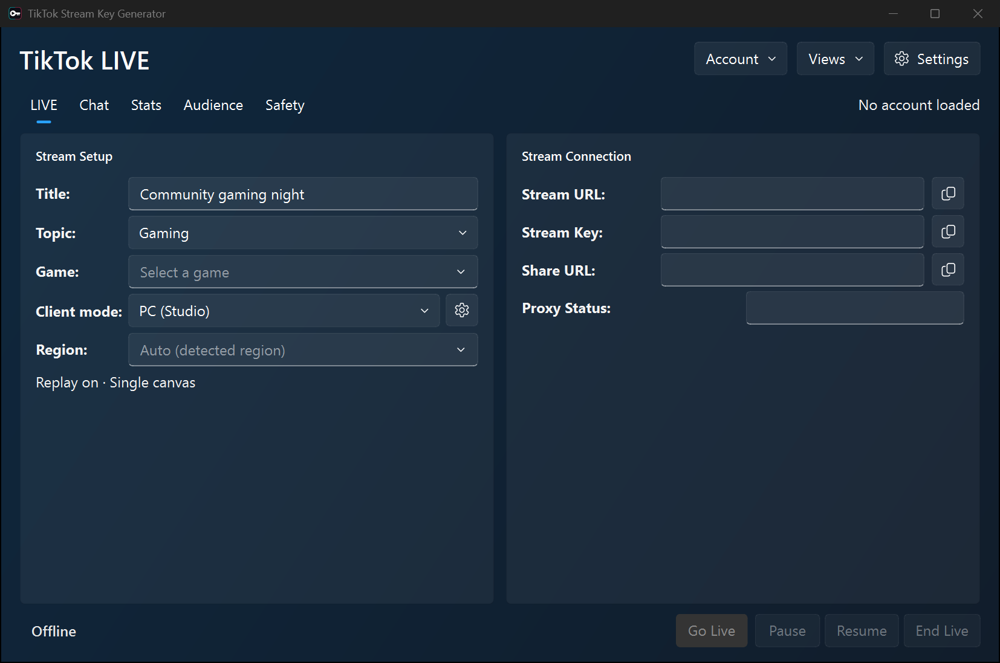
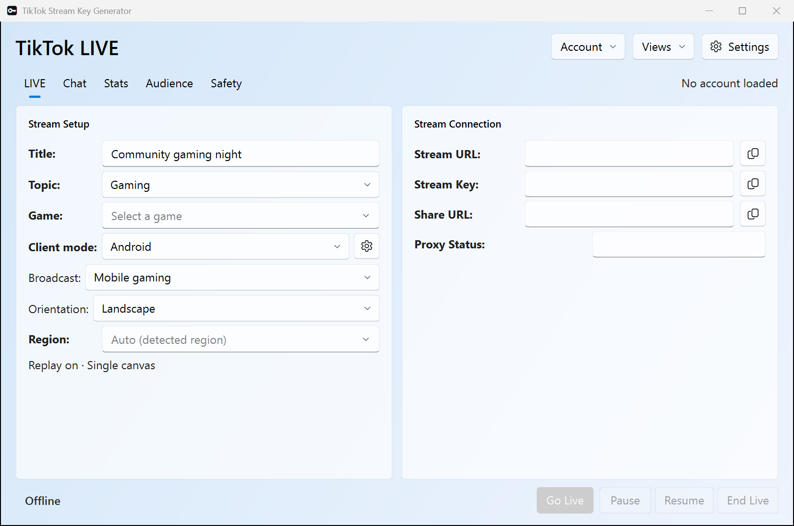
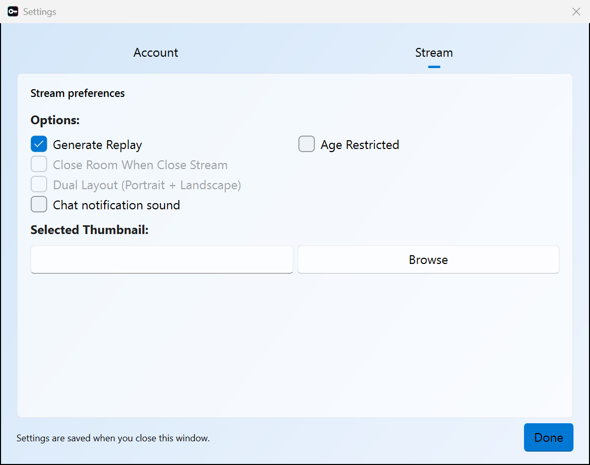

# TikTok Live Stream Key Generator for OBS Studio

This project creates a TikTok LIVE room and gives OBS an RTMP target through a local FFmpeg proxy. OBS does not stream directly to TikTok; it streams to the local proxy, and the proxy forwards the stream with the metadata TikTok expects.

For most users, [Loukious/StreamLabsTikTokStreamKeyGenerator](https://github.com/Loukious/StreamLabsTikTokStreamKeyGenerator) is still the preferred option. It has a smaller architecture, fewer moving parts, and therefore less that can go wrong. Use this project if you specifically need the newer local FFmpeg proxy flow, SEI injection path, RapidAPI signing integration, or the extra GUI controls here.

[](https://buymeacoffee.com/loukious)

## Screenshots

Screenshots of the current app rendered offline with demo settings; no account cookies or stream keys are shown.

**Desktop stream setup · dark appearance**



**Android mobile gaming · light appearance**



**Stream settings**



## What It Does

- Creates a TikTok LIVE room.
- Retrieves the stream server, stream key, and share URL.
- Supports OBS Studio by exposing a local RTMP server/key pair.
- Runs a local FFmpeg RTMP proxy between OBS and TikTok.
- Adds the LIVE Studio-style stream metadata needed by the proxy path.
- Supports game/topic tags, replay settings, mature content, thumbnails, region priority, and ending the room from the app.
- Uses RapidAPI for request signing and stream frame signing.
- Keeps separate PC and Android device profiles, with account-gated dual layout.
- Reads LIVE chat and gifts with automatic reconnect and optional notification sound.
- Imports saved LIVE Studio accounts on Windows and caches viewed campaign IDs.

## Architecture

The supported streaming path is:

1. The app creates a TikTok LIVE room and receives the real TikTok push URL/key.
2. The app starts a local FFmpeg RTMP proxy.
3. OBS connects to the local RTMP address shown by the app, usually something like `rtmp://127.0.0.1:<port>/...`.
4. The proxy receives the OBS stream, adds the stream metadata path TikTok expects, and forwards it to TikTok.

The real TikTok URL/key is not meant to be used directly in OBS. In current testing, TikTok closes direct OBS connections immediately, and using the real TikTok URL/key without the LIVE Studio-style stream metadata can lead to a LIVE visibility restriction for integrity/authenticity.

The local proxy exists because TikTok LIVE Studio sends extra stream-side metadata while pushing video. OBS does not send that metadata by itself. The proxy lets OBS stay simple while the app handles the TikTok-specific stream wrapping before forwarding.

## RapidAPI Signing

Production builds require a signer API key for TikTok request headers and stream frame signing. The app does not explain or expose the signing algorithms; it calls the hosted signer API and uses the returned values.

You need a RapidAPI key from:

[TikTok LIVE Studio API Signer on RapidAPI](https://rapidapi.com/Loukious/api/tiktok-live-studio-api-signer1)

After subscribing:

1. Open the app.
2. Paste your RapidAPI key into the **RapidAPI Key** field.
3. Save/apply it.
4. Start the stream normally.

Without a valid RapidAPI key, streaming is expected to fail or receive a LIVE visibility restriction such as an integrity/authenticity violation. Treat the RapidAPI key as required, not optional.

Error dialogs use typed `HostedSignerError` exceptions defined in
`Libs/error_reporting.py`. Categories come from HTTP status codes, missing-key
checks, rate-limit state or response validation. Exception objects and explicit
causes survive GUI signals and operation wrappers. The proxy child reports its
terminal error through a versioned JSON file unique to each launch; the parent
consumes that report and removes it. Missing or invalid reports produce an
ordinary proxy error. Message text and human-readable logs never determine
whether a failure belongs to RapidAPI.

## Requirements

- Python 3.13 for the supported build workflow; Python 3.10+ for source runs with compatible dependencies.
- FFmpeg available on `PATH`.
- OBS Studio.
- TikTok LIVE access.
- TikTok LIVE Studio access or an account that has already been enabled for LIVE Studio.
- A valid RapidAPI key for this app's signer API.

## Installation

Download the latest release from:

https://github.com/Loukious/TikTokStreamKeyGenerator/releases/latest

Or run from source:

```bash
pip install -r requirements.txt
```

If `pip` is not available:

```bash
python -m pip install -r requirements.txt
```

## Usage

Run the GUI:

```bash
python TiktokStreamKeyGenerator.py
```

Then:

1. Log in to TikTok.
2. Enter your stream title and game/topic options.
3. Paste your RapidAPI key if it is not already saved.
4. Click **Go Live**.
5. Copy the local server/key shown by the app into OBS.

OBS should use the local RTMP server/key shown by the app, not the real TikTok URL/key.

## Logging In With Exported Cookies

If browser login is unavailable or keeps failing, you can skip it by importing cookies from a browser where you are already logged in to TikTok:

1. Install the [Export cookie JSON file for Puppeteer](https://chromewebstore.google.com/detail/export-cookie-json-file-f/nmckokihipjgplolmcmjakknndddifde) extension in Chrome.
2. Log in to TikTok in Chrome and stay on a `tiktok.com` page.
3. Click the extension icon and export the cookies. It downloads a JSON file containing the session for the site you are on.
4. In the app, point the **Cookies file** field at the downloaded JSON file (type or paste the path, or edit `cookies_path` in the config), then use **Refresh Account Info**.

The exported file is a JSON array of `{name, value, domain, ...}` cookie objects, which is the format the app reads directly.

Notes:

- Make sure you export while logged in with the account you intend to stream from.
- Cookie files are live account credentials. Do not share them or commit them to git.
- Sessions expire; if the app stops authenticating, log in again in the browser and export a fresh file.
- On macOS, the app keeps its settings (`config.json`), the default `cookies.json`, and its logs in `~/Library/Application Support/TiktokStreamKeyGenerator/`, not inside the `.app` bundle. The easiest way to import cookies is the **Browse** button next to the Cookies file field — it accepts the exported file from anywhere, such as your Downloads folder.

## Dual Layout (Portrait + Landscape)

Dual Layout is available for PC and **Mobile → Camera LIVE** after **Refresh Account Info** confirms account access. The account must return `allow_multi_stream=true` for game create-info `scene=1`, plus `allowed=true` **or** `dual_canvas_used=true` from the threshold check. Unknown/failed checks keep the option disabled. Switching mobile Broadcast to screen capture disables and unchecks Dual Layout; switching back to Camera LIVE restores eligibility.

Android dual creation keeps Android AID 1233, version 47.1.4 and Android signing. Its camera form adds `live_studio=1`, `multi_stream_scene=1`, `multi_stream_source=1`, with query `live_mode=6`. Screen-capture fields are omitted even if present in saved query overrides. Both account gates are rechecked before creation. Two distinct push URLs and a nonzero secondary stream ID are required before starting either proxy; a newly created incomplete room is finished, with cleanup failures reported.

This Android request allocated both streams in the 2026-10-13 experiment. Sustained dual-feed ingestion and viewer layout switching with Android frame signatures remain unverified.

Check **Dual Layout (Portrait + Landscape)** in the Options before clicking **Go Live** to create a `multi_stream_scene=1` room with two canvases. The app then starts two signed local RTMP listeners:

- **Stream URL / Stream Key** (labeled *Landscape* in dual mode) — the existing endpoint, by default `rtmp://127.0.0.1:19350/live/obs`, forwards to the room's **landscape** canvas (`multi_stream_url`). Existing OBS setups keep working unchanged.
- **Portrait Stream URL / Stream Key** — a second endpoint, by default `rtmp://127.0.0.1:19351/live/portrait`, forwards to the room's **portrait/vertical** canvas (the main `stream_url`).

Feed the portrait endpoint from a second encoder output: an OBS multi-RTMP output plugin, a second OBS instance with a vertical canvas, or an `ffmpeg` push.

Notes:

- The account must be allowed dual layout. If TikTok does not return a second push URL, the app ends the freshly created room and tells you to retry without the checkbox.
- Resuming an existing room only stays dual when that room has a `multi_stream_url`; otherwise the app continues with the main canvas only.
- If either proxy process dies, forwarding is halted on both endpoints (signed metadata can no longer be trusted for the room).
- Both endpoints sign with the same SEI parameters as the single-stream proxy.

## Output

The app can show:

- **Server URL:** The RTMP server OBS should connect to.
- **Stream key:** The OBS stream key.
- **Share URL:** A public link to the TikTok live room.

The shown server/key are local proxy values. The app keeps the real TikTok push URL internal so OBS only talks to the local proxy.

## FAQ

### macOS says the app is damaged or cannot verify the developer. How do I open it?

After downloading the app from this project's release page and extracting the ZIP:

1. Move `TiktokStreamKeyGenerator.app` to your Applications folder or another location.
2. Open **Terminal**.
3. Run the command below, replacing the quoted path with the actual app location. You can drag the app from Finder into Terminal to insert its path.

   ```bash
   xattr -dr com.apple.quarantine "/path/to/TiktokStreamKeyGenerator.app"
   ```

4. Try opening the app again.

For example, if it is in Applications:

```bash
xattr -dr com.apple.quarantine "/Applications/TiktokStreamKeyGenerator.app"
```

Only do this for a download you trust: the command removes macOS's downloaded-file quarantine flag. It does not repair a corrupted app or grant TikTok LIVE access. Windows code signing does not sign or notarize the macOS bundle.


### What should I use for priority_region, including Taiwan accounts?

Leave **Region** blank for **Auto**. For PC and Android modes, the app reads `data.priority_region` from LIVE Studio's `/webcast/game/basic/region_check/` during account refresh and caches it separately for each account/session and client mode. Room startup refreshes a missing context. The account/store country and server data center are separate: `x-tt-store-region` follows the account region, and domain routing follows TikTok's session cookies and dispatch configuration.

Use `tw` only when it matches the actual Studio environment's returned or captured priority region. A Taiwan account alone does not establish that value. An explicit Region selection is a manual override; it does not change the account's country. The endpoint was also verified with Android-signed requests. If discovery is unavailable, Auto retains a cached result or a valid captured Android profile priority; otherwise it leaves the priority empty instead of guessing from the account country. Manual selection takes precedence over saved profile values.

Changing this query parameter requires signing the updated query. Argus includes the query digest. `x-ss-stub` hashes the request body, so it remains the same if the body is unchanged. Ladon uses the timestamp, app/license identifiers and a random prefix; different Ladon strings alone do not demonstrate a region dependency. Compare signatures only with timestamps and randomness controlled.

### Why is the StreamLabs project preferred?

It has a smaller flow and fewer dependencies. This project has more advanced features, but that also means more components: login, room creation, request signing, FFmpeg, local RTMP proxying, and stream metadata injection.

### Why do I need FFmpeg?

FFmpeg is used as the local RTMP receiver/forwarder. OBS streams to FFmpeg locally, and FFmpeg forwards the stream after the app adds the TikTok-specific stream metadata path. Direct OBS-to-TikTok streaming is not the supported path here.

### Why do I need RapidAPI?

TikTok LIVE Studio requests and stream metadata require signed values. The app gets those signed values from the RapidAPI signer service. Without them, the stream can be restricted for integrity/authenticity.

### Do I need TikTok LIVE access?

Yes. The app cannot give LIVE access to accounts that do not already have permission to go live.

### I get a login error. What should I do?

Try logging in again, restarting the app, or using another available TikTok server/region option. If browser login is blocked, you can import cookies exported from your browser instead — see [Logging In With Exported Cookies](#logging-in-with-exported-cookies).


## PC and Android modes

Choose **PC (LIVE Studio)** or **Mobile (Android)** in the Client mode selector.
PC is the default. Both PC and Android installations are prepared at startup,
before login: each gets its own randomized hardware fingerprint and local
identifiers, and registration of missing device/install IDs is attempted in the
background. Existing IDs are retained. Each successful profile is saved under
`devices.pc` or `devices.mobile` in config.json, even if the other registration
fails. **Retry device setup** retries only incomplete profiles using the same
saved local installation. An existing PC-only config automatically initializes
its missing Android profile. Registration is local in both dev and production.

**Device settings** contains only **Device ID** and **Install ID**, which you can
edit or import. All other hardware/installation fields are generated and saved
automatically. Saving IDs preserves their profile's hidden settings. Broadcast
and orientation selectors belong only to Stream Setup. Client selection stays available during account refreshes; switching cancels the
previous UI load and ignores its later results, even when switching back to the
same client. Each load uses a fixed cookie path and device profile, and a stalled
load times out after 60 seconds. Device settings and broadcast options remain
locked during a LIVE, registration or an in-flight account/stream request.

Mobile uses Android AID 1233, `iid`, Android version/device fields, and a separate
room form. Single-canvas requests omit Studio browser fields and dual-canvas
parameters. Camera LIVE supports the dual option described above. PC browser
login, close-on-disconnect, and desktop pause/resume are disabled in mobile mode. Import your Android session cookies. In Stream Setup, choose **Camera LIVE** (the default) or **Mobile gaming (screen capture)**
from the Broadcast selector. Gaming shows a **Portrait / Landscape** orientation
selector; select the Gaming topic to choose a game tag. Screen capture uses one canvas.
Camera LIVE uses one canvas unless Dual Layout is enabled.
The choice and gaming orientation are saved in `devices.mobile` and restored when
switching clients or restarting. These controls are locked during a LIVE or an
in-flight account/stream request. Android screen capture sends `screen_shot=1`,
`live_room_mode=4`, orientation (Portrait=1, Landscape=2), and the game tag.
Camera requests omit those fields. Existing captured `create_params`, SDK state,
registration options and query overrides are preserved in config when editing
the IDs; they are not exposed as device-setting inputs.

Use **LIVE Campaigns** in the account panel to load the Campaign Center cards for
the selected PC or Android account. The dialog shows titles, activity IDs, states,
dates in UTC and a **Viewed** column, with search and state filters. Hover a title
to see its description. Double-clicking a campaign or using **Mark as viewed**
submits `visit_specific_campaign_page` using the account from your
cookies. **Viewed** becomes **Yes** after TikTok accepts the event. Refreshing or
filtering the list or single-clicking a row sends no view events. Accepted events are sent only once per
activity/account, including after reopening the dialog or restarting the app.
Confirmed activity IDs are cached per account in `campaign_views.json` beside
the app configuration; failed or unconfirmed requests are not cached. View requests
are not automatically retried or redirected; a network failure can leave receipt
unconfirmed. TikTok determines whether an accepted event credits a campaign task.
The native preview-display event (`type=3`) is a different event.

Campaigns use the existing signing backend: local DevTools in development and
the signer API in released builds. No campaign signing algorithms are published
in Libs. The current Campaign Center contract comes from TikTok's frontend;
PC also supports the older `ls/pack_data` response captured from LIVE Studio.
Offline coverage validates requests, capture parsing and GUI behavior. A PC
read-only check succeeded against the current Campaign Center endpoint. Android
live listing and view-event acceptance still require live verification.

Source runs and released builds default to hosted signing through the `Libs` API wrappers.
The ignored `DevTools` directory is excluded from releases. Android header/frame
signing algorithms, native assets, license, and compressor are confined to DevTools.
Device registration and its body codecs are public `Libs` code in both modes.
Install development dependencies with `python -m pip install -r requirements-dev.txt`.
Maintainers with the private local signing tools can explicitly set
`TIKTOK_SIGNER_MODE=dev`. Those tools are not part of this repository. Packaged
builds refuse development mode and never fall back to a local signer.

Production mobile signing checks `/health` for Android support. Deploy the updated
FrameSignTiktok API and expose `/health` through the gateway. The optional
`TIKTOK_MOBILE_API_ENABLED=1` bypasses discovery; `0` explicitly disables mobile.
The prepared `/signatures` contract adds `implementation: "mobile"`, the exact
`url`, request `headers`, `body_base64`, and `install_id` to the existing fields.
Android responses must include x-gorgon as well as x-argus/x-ladon/x-khronos.
`/framesign` adds `implementation: "mobile"` and `sdk_context`, and must return
`signversion: "2.0"`. Mobile bypasses the PC frame batch cache. PC API requests
keep their existing payload schema. The updated FrameSignTiktok server defaults
to PC for all existing clients.

The Android backend executes the recovered TikTok 47.1.4 algorithms with offline
SDK state. LIVE signing and server acceptance have not been verified. Use
captured Android device/request settings; the GUI does not manufacture Android
server-issued device/install IDs.


Android registration runs automatically at startup alongside PC setup, using
generated hardware and local identifiers stored under `devices.mobile`. It runs
in a worker and does not log in or start a broadcast. There is no hardware or
registration form in Device settings. Advanced captured AppLog header/query
fields can still be supplied in config.json through `fingerprint` and
`registration_options`.
Default encoding is `ttencrypt`: compact JSON is gzip-compressed, then encrypted.
`registration_options.encoding` can explicitly select standalone `gzip` for
AppLog diagnostics. `json-gzip` selects the captured TTNet format: JSON content
type, `x-bd-content-encoding: gzip`, no `tt_data`, and JSON MD5 before compression.
`json` selects plain JSON matching the first-start boot capture.
`.host` can select log-va.tiktokv.com, api.tiktokv.com, aggr32-normal.tiktokv.com
or api-boot.tiktokv.com.
The default remains the unsigned ttEncrypt registration path. Request URLs also
include `device_platform=android` and the numeric app `version_code`; the SDK
signer requires those endpoint parameters for the verified signed registration
path. Signed plain JSON, JSON-gzip and ttEncrypt registration returned fresh IDs
in the diagnostic checks; the GUI bootstrap still uses its public local code.

Like PC registration, the entire Android registration flow runs locally in
public `Libs` code: identity generation, request construction, body encoding,
direct TikTok POST and response parsing. The Python ttEncrypt implementation is
`Libs/mobile_log_encrypt_codec.py`; neither body encoder loads libEncryptor.so.
Registration requires no signing API, API key or DevTools, including in packaged
builds. `Libs.device_gen.register_mobile_device_identifiers` follows the PC
interface: `(session=None, timeout=25, *, device_profile=None, return_profile=False)`.
It returns `(device_id, install_id)` by default, or the complete Android record
with `return_profile=True`. The GUI saves that record independently of PC.
Header/frame signing for LIVE requests continues to use DevTools in development
and the API in production; the Android header signer still uses native emulation.
Android common URL parameters distinguish the app code (`version_code=470104`
for 47.1.4) from the APK build codes (`manifest_version_code` and
`update_version_code`, both 2024701040 by default). The app code follows
`app_version`; existing saved build codes stay compatible. This mapping is
applied before every Android request is signed. Android domain discovery also
includes the pinned `cronet_version` and `ttnet_version`; omitting them returned
no dispatch rules in the comparison, while including both returned 128.
Live checks identified the missing transport step: standalone gzip and
ttEncrypt over uncompressed JSON both returned HTTP 200 with zero IDs.
Gzip-compressing before ttEncrypt returned valid server-issued Android device
and install IDs, including with the original minimal headers/query. The GUI
uses this corrected Python path in both development and production. It retains
local identifiers on failure and retries only missing profiles. Existing PC IDs
stay usable; PC registration and signing are unchanged.
Failed setup shows a **Details** button with the actual registration error.

Qt font warnings remain visible in the console. If a `QFont::setPointSize`
warning recurs, the app also appends its Python call stack to
`logs/qt-font-warnings.log` beside the script (or the app's user data on macOS).
Tool buttons and native tooltip fonts now use valid point sizes. This corrects
the Windows rendering warning associated with hovering Device settings.
Changing client mode also reloads account info when that profile has registered
IDs and a valid cookies file, instead of leaving the account display empty.

## Fluent interface

The PySide6 app uses the matching QFluentWidgets build for controls, cards,
menus and system light/dark themes. Appearance and accent colors follow the
desktop while the app is running, using Qt's `QStyleHints` and `QPalette.Accent`.
The native window and text/input palette stay inherited from the OS;
they are no longer replaced with fixed Fluent gray colors.
The workspace, app dialogs and popup menus paint a soft gradient tinted with the system accent over
this palette, giving the surrounding background and translucent cards some
color. The workspace stays opaque and updates with appearance/accent changes.
Update and confirmation message boxes use the same tinted surface. The Offline
status has a transparent background so it blends into the workspace.
Stream creation, resume/pause/end, proxy startup and shutdown, QR/browser login,
game-list loading, and Studio cookie import run blocking work in background
threads. Qt keeps animating the loading indicators while requests are pending.
Browser login can be cancelled; its temporary protocol registration is restored
before the operation finishes. Campaign cache reads and writes also run in workers.
Windows and macOS expose these settings through Qt; on Linux, availability
depends on the desktop environment and Qt platform-theme integration. The app
uses the native background's brightness where no named light/dark preference is reported.
Primary buttons choose readable text/icon colors for the selected accent.
No extra Python theme package is required. The default window is 1040×640 and its
workspace does not scroll. **LIVE** shows setup and stream connection fields;
**Chat**, **Stats**, **Audience** and **Safety** have separate views. Stream controls stay
visible at the bottom on every view. Table rows scroll within their own tables.

The app keeps the normal native title bar on each platform, with the standard
minimize/maximize/close buttons, dragging, resizing and Snap. No custom title-bar
transparency or backdrop effect is applied.

The application artwork is in `assets/app-icon.png`; `assets/app-icon.ico`
contains 16–256 px sizes for Windows, including fractional DPI scaling. The same
icon appears in the native title bar and in newly built Windows executables.
Release builds include both assets; Windows builds embed the ICO and macOS
bundles use the PNG. Existing executables need rebuilding to update their file icon.

Use **Account** for login, cookie import, account refresh and LIVE campaigns.
On Windows, **Account → Import from LIVE Studio…** lists Studio's saved accounts
and lets you select one without switching Studio's active account. The selected
session is saved as `cookies_<username>.json` beside this app's EXE (beside the
source script when running Python), then loaded and refreshed. Reimporting updates
that account's export. The importer reads `%APPDATA%\TikTok LIVE Studio\TTStore\services.json`
and works while Studio is open; it does not alter Studio's files or combine cookies
from different accounts. Saved sessions can expire; sign in again in Studio and
reimport if account refresh reports an expired session.
**Settings** contains Account settings (cookies, account facts and the API key
in production) and Stream preferences (replay, age restriction, close behavior,
dual layout and thumbnail). Settings are saved when the dialog closes.
The **Views** menu shows or hides Chat, Stats, Audience and Safety, remembers your
choices and offers **Restore default views**. Hiding a view does not stop
monitoring or suppress LIVE violation alerts. The LIVE view is always available.
Right-click the workspace for device/settings, refresh and copy actions; the
same features remain available through visible menus and buttons. Shortcuts:
Ctrl+1–4 selects the existing views, Ctrl+5 opens Chat, Ctrl+, opens Settings,
and Ctrl+S saves settings.

The **Chat** view starts reading viewer comments and gifts when a LIVE is created or
resumed, and stops when the LIVE ends or the app closes. It shows connection
status, automatically reconnects after errors or an unresponsive socket with
delays from 1 to 30 seconds, and fetches fresh connection tokens on every retry.
It requests missed messages using the last cursor and suppresses duplicate
message IDs across automatic reconnects; TikTok controls how much history can
be recovered. **Reconnect** retries immediately; **Clear** clears the display.
The display retains up to 1,000 lines in memory and stays at your scroll position
when you scroll back. Entries are plain text and are not saved to disk.
There is no message sending or moderation interface.

**Settings → Stream → Chat notification sound** enables the system notification
sound for new comments and gifts. It is off by default and saved when Settings
closes. A batch of incoming messages produces one sound; replayed messages and
updates to unfinished gift streaks do not notify again. Qt uses the operating
system's notification sound, so no extra audio package or sound file is needed.

Gifts appear inline, for example `🎁 Alex sent Rose ×10`. Gift handling follows
LIVE Studio's chat-buffer rule: small gift streaks appear once when the server
sends `repeatEnd`; large, face-effect and music gifts appear immediately.
The displayed quantity is the server's `repeatCount`, not a sum of intermediate
streak updates. Completed small streaks are identified by gift ID, sender ID,
group ID and group count, matching Studio's combo key, and duplicate deliveries
are suppressed across automatic and manual reconnects. If the gift name is
absent, its ID is shown. Gift animations and monetary totals are not part of this
text feed. The rules were checked in Studio 1.37.4's bundled GiftService
(`static/js/async/86496.3b6b3704.js`) and GiftType enum (`static/js/main.af7b32f7.js`).

Chat uses the captured LIVE Studio web IM transport, signed with the existing
Studio signer and the selected account's cookies. This transport is independent
of PC/Android stream creation: Android-created rooms use the saved PC profile
for chat without replacing their Android device IDs. `Libs/live_chat.py` owns
the worker, comment/gift protobuf decoding, acknowledgements, heartbeats and reconnection.
The cross-platform WebSocket dependency is installed by `requirements.txt`;
the development environment has been updated as well. Bootstrap and socket
decoding were checked against local Studio captures. Live gift delivery and
comment delivery in an Android-created room still need a live-session check.

Install the matching Qt binding with
`python -m pip install "PySide6-Fluent-Widgets" -i https://pypi.org/simple/`,
or install the updated requirements.txt. The PyQt5 distribution named
PyQt-Fluent-Widgets cannot be mixed with this PySide6 app; the variants share the
same qfluentwidgets import package. See https://qfluentwidgets.com/pages/install/.

Device/profile, GUI and campaign checks run without real config or networking:
`python -m unittest tests.test_device_setup tests.test_client_modes tests.test_campaigns`.
Chat protocol, reconnect and GUI lifecycle checks:
`python -m unittest tests.test_live_chat`.
System appearance synchronization and accent contrast checks:
`python -m unittest tests.test_system_theme tests.test_fluent_menus`.
Windows Studio import, account isolation and file export checks:
`python -m unittest tests.test_studio_cookies`.


## Building and Windows code signing

The [Release workflow](.github/workflows/release.yml) builds native standalone bundles with Python 3.13 and Nuitka. Runtime dependencies are in `requirements.txt`, build dependencies in `requirements-build.txt`, and offline test dependencies in `requirements-test.txt`. Qt Fluent Widgets, WebSocket chat, application icons, FFmpeg and its included license files are bundled. Private development tools and local data are excluded.

Run **Actions → Release → Run workflow** and enter the numeric version and release notes. Every run builds all five packages: Windows x86_64 Release and Debug, Linux x86_64, macOS Intel, and macOS Apple Silicon. There is no partial-platform release option. All builds run an offline packaged-runtime check before signing.

The default `signing_policy: release-signing` selects SignPath's `release_certificate_2026`. Production signing requires an issued certificate and a valid SignPath policy. For a test build, select `test-signing` and leave `publish: false`.

Select `publish: true` on `Loukious/TikTokStreamKeyGenerator` to publish all completed packages together. Other repositories only produce workflow artifacts and cannot publish releases. Both stable releases and pre-releases require production Windows signing; unsigned and test-signed packages remain workflow artifacts only.

Windows signing uploads only `TiktokStreamKeyGenerator.exe` as a GitHub artifact ZIP, submits its artifact ID to SignPath, downloads and verifies the signed EXE, then replaces the unsigned EXE before creating the final downloadable ZIP. Bundled third-party DLLs and FFmpeg retain their original signatures. A signing or verification error fails the build; it never silently ships an unsigned replacement.

See [SignPath setup](docs/signpath.md) for the organization/project settings, artifact XML, CI secret and production certificate requirements. Test-signed Windows packages are labeled `-test-signed`; their self-signed certificate is not publicly trusted and will not remove SmartScreen warnings. Publication requires the `release-signing` policy; macOS signing/notarization is a separate setup.

To run the shareable offline checks:

```bash
python -m pip install -r requirements-test.txt
python scripts/run_tests.py
```
